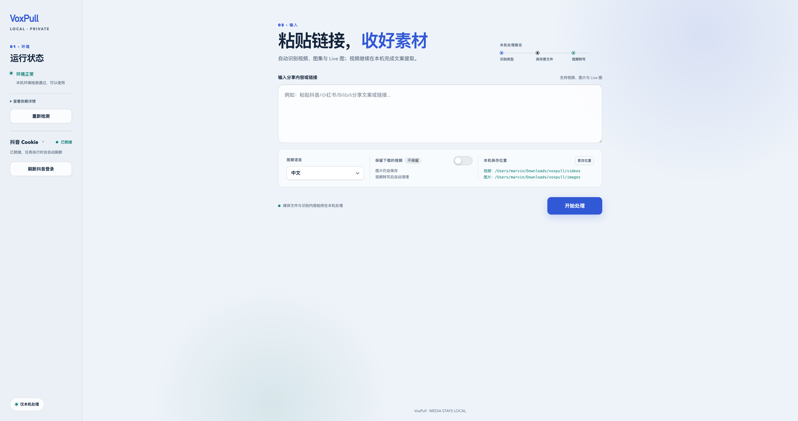
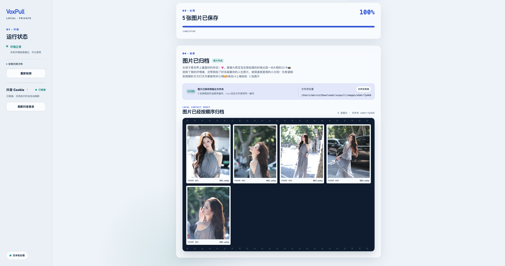
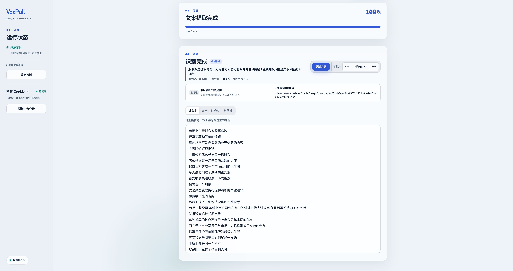

> 本文件保留上游项目的使用说明与截图。当前定制版本及发布范围，请优先阅读[仓库主页说明](../README.md)。

# VoxPull

[](LICENSE)

VoxPull 是一个本地媒体归档与视频转写工具。粘贴抖音、小红书、Bilibili 等平台的分享链接，即可保存视频、图集和 Live 图；视频会继续通过本机的 whisper.cpp 提取文案。

> 服务默认只监听 `127.0.0.1`。媒体需要联网下载，音频和语音识别始终在本机进行；只有用户主动
> 生成 AI 总结时，当前编辑的文案和时间轴文本才会发送给 DeepSeek。

## 功能

- 保存抖音、小红书图集；Live 图会同时保存静态图片和动态 MP4，并可在预览页带声播放和重播；
- 下载抖音、小红书、Bilibili 及其他 yt-dlp 可解析的视频并在本机转写；
- 支持中文识别或自动判断语言，可选择是否长期保留原视频；
- 在线校对、复制文案，导出 TXT、时间轴 TXT 和 SRT；
- 视频转写完成后可按需用 DeepSeek 生成要点速览或详细段落，并以 Markdown 展示；
- 自动复用已下载的同一作品，支持任务队列和分阶段并发处理；
- 在网页中检查运行依赖、管理抖音登录并查看处理进度。

**粘贴链接，统一配置处理选项**



**图片与 Live 图按原顺序归档**



**视频文案在线校对并按需导出**



## 快速开始

当前推荐 Apple Silicon Mac，并需要：

- [Homebrew](https://brew.sh/zh-cn/)；
- 可用的网络；处理抖音链接时还需要抖音账号；
- Whisper 模型约 514 MiB，另需为 Chromium、依赖和媒体预留空间。

项目不要求预先安装 Python。进入项目目录后执行：

```bash
brew install uv
chmod +x scripts/bootstrap.sh
./scripts/bootstrap.sh
```

初始化脚本会准备 Python 3.14、项目依赖、Chromium、ffmpeg、whisper.cpp、Whisper 和 VAD 模型，
并安装全局 `vox` 命令。遇到系统依赖和模型下载确认时输入 `y`；也可以无交互执行：

```bash
VOXPULL_INSTALL_SYSTEM=1 VOXPULL_DOWNLOAD_MODEL=1 ./scripts/bootstrap.sh
```

安装完成后启动服务：

```bash
vox start
```

浏览器打开 <http://127.0.0.1:18765>。服务在后台运行，关闭终端不会中断。

## 使用

1. 等待网页完成环境检测。只有处理抖音链接时，才需要点击“初始化 / 刷新”，在打开的
   Chromium 中登录，再回到网页点击“已登录，保存 Cookie”。
2. 粘贴链接或包含链接的整段分享文案，选择视频语言和是否保留原视频，然后提交。
3. 图集完成后可直接预览；视频完成后可校对、复制或下载识别结果。

需要修改媒体保存位置时，在“本机保存位置”中点击“更改位置”并选择一个文件夹。VoxPull
会在所选文件夹下分别创建 `work/`、`videos/` 和 `images/`，并在下次启动时继续使用该位置。
不保留的视频会暂存在 `work/` 中，处理完成后自动删除。任务处理期间不能切换保存位置。

图片作品始终保存。每个作品位于 `data/images/<10 位短标识>/`，文件按 `001`、`002`……排序；
小红书 HEIC/HEIF 原图会在本机无损转换为全分辨率 PNG，以便在网页中直接预览；
Live 图使用同编号的图片和 `*.live.mp4`，并附带 `manifest.json`。

视频开启“保留下载的视频”后以稳定的 10 位文件名保存到 `data/videos/`，再次处理同一作品会
复用；关闭后，10 位文件名的临时 MP4 会在转写结束时删除。网页中修改过的文字只影响复制和
TXT，时间轴 TXT、SRT 仍使用原始分段结果。

任务和识别结果只保存在当前服务进程中，重启服务前请及时导出重要内容。Cookie 和浏览器
资料保存在 `data/auth/`、`data/browser-profile/`，请勿分享。

### AI 视频总结

视频转写完成后，可以在结果页配置 DeepSeek API Key 并生成总结。功能固定使用
`https://api.deepseek.com` 的 `deepseek-v4-flash`，不支持其他供应商、地址或模型。API Key 只保留
在 `data/auth/deepseek-auth.json` 中，并会以仅当前用户可读写的权限创建。`data/` 已被 Git 忽略，
不会上传到仓库；API Key 不会出现在接口响应或日志中。

生成总结会将当前编辑器中的文案及原始时间轴文本传给 DeepSeek。请勿对敏感、个人或商业秘密内容
使用此功能。模型会保守处理常见的识别错字、同音词和标点问题，但不会修改原始转写；AI 生成的
AI 总结仍可能有遗漏或错误，应在使用前复核。

## 常用命令

| 命令 | 说明 |
| --- | --- |
| `vox start` | 后台启动服务 |
| `vox restart` | 重启服务 |
| `vox status` | 查看状态、地址和日志位置 |
| `vox stop` | 停止服务 |
| `vox port` | 输出当前端口 |
| `vox unstall` | 卸载命令、项目环境、Chromium、模型和运行日志 |
| `vox help` | 查看命令帮助 |

`vox unstall` 会保留源码、`data/` 中的用户数据，以及 Homebrew 安装的共享依赖。

开发或排障时可在项目目录以前台方式运行：

```bash
uv run voxpull
```

按 `Control + C` 停止。

## 配置

无需修改配置即可使用。环境变量应放在启动命令前，例如：

```bash
VOXPULL_PORT=18766 vox start
```

| 环境变量 | 默认值 | 说明 |
| --- | --- | --- |
| `VOXPULL_HOST` | `127.0.0.1` | 监听地址 |
| `VOXPULL_PORT` | `18765` | 服务端口 |
| `VOXPULL_DATA_DIR` | `data/` | Cookie、浏览器资料和媒体目录 |
| `VOXPULL_MODEL_PATH` | `models/ggml-medium-q5_0.bin` | Whisper 模型 |
| `VOXPULL_VAD_MODEL_PATH` | `models/ggml-silero-v6.2.0.bin` | Silero VAD 模型 |
| `VOXPULL_FFMPEG_BIN` | `ffmpeg` | ffmpeg 命令或路径 |
| `VOXPULL_WHISPER_BIN` | `whisper-cli` | whisper.cpp 命令或路径 |
| `VOXPULL_MAX_QUEUE` | `10` | 最大等待任务数 |
| `VOXPULL_MAX_CONCURRENCY` | `5` | 最大同时处理任务数 |
| `VOXPULL_DOWNLOAD_CONCURRENCY` | `5` | 最大同时探测或下载任务数，也是图片文件并发上限 |
| `VOXPULL_FFMPEG_CONCURRENCY` | `2` | 最大同时音频转换数 |
| `VOXPULL_WHISPER_CONCURRENCY` | `2` | 最大同时语音识别数 |
| `VOXPULL_SUMMARY_TIMEOUT` | `180` | 单次 DeepSeek 总结的总超时秒数 |
| `VOXPULL_SUMMARY_CONCURRENCY` | `2` | 最大同时生成 AI 总结数 |
| `VOXPULL_SUMMARY_MAX_INPUT_CHARS` | `200000` | 当前编辑文案可用于总结的最大字符数 |
| `VOXPULL_STATE_DIR` | `~/.local/state/voxpull` | 后台状态和日志目录 |

后台日志使用本地时间，每天 `00:00` 自动轮转并清理，仅保留最近 3 个自然日。当前日志为
`server.log`，历史日志以 `server.log.YYYY-MM-DD` 命名；每条日志都包含日期、时间、级别和模块名。

超时还可通过 `VOXPULL_BROWSER_TIMEOUT`（120 秒）、`VOXPULL_DOWNLOAD_TIMEOUT`（900 秒）、
`VOXPULL_FFMPEG_TIMEOUT`（900 秒）和 `VOXPULL_WHISPER_TIMEOUT`（3600 秒）调整。修改后台
服务配置时，先执行 `vox stop`，再用新变量启动。

模型下载默认先使用 `https://hf-mirror.com`，失败后尝试 Hugging Face 官方源；可通过
`VOXPULL_HF_ENDPOINT` 更换镜像，或用 `VOXPULL_MODEL_URL`、`VOXPULL_VAD_MODEL_URL` 分别指定下载直链。

## 常见问题

### `vox: command not found`

在项目目录重新运行 `./scripts/bootstrap.sh`。若初始化已经成功，执行 `uv tool update-shell`，
完全关闭并重新打开终端。

### 网页打不开或启动失败

执行 `vox status`，打开它显示的地址。默认日志位于
`~/.local/state/voxpull/server.log`：

```bash
tail -n 100 ~/.local/state/voxpull/server.log
```

端口被占用时可换端口启动：

```bash
VOXPULL_PORT=18766 vox start
```

### Chromium、ffmpeg、whisper.cpp 或模型缺失

```bash
uv run playwright install chromium
brew install ffmpeg whisper-cpp
VOXPULL_DOWNLOAD_MODEL=1 ./scripts/bootstrap.sh
vox restart
```

只需执行与缺失项对应的命令。

### 识别结果反复出现同一句

这通常是 Whisper 把静音、纯音乐或底噪误判为语音后产生的幻觉，历史文本上下文会让错误在
后续分块中自我强化。VoxPull 默认用 Silero VAD 过滤无人声区间，并限制 Whisper 的文本上下文长度。
如果环境检查显示 VAD 模型缺失，请执行：

```bash
VOXPULL_DOWNLOAD_MODEL=1 ./scripts/bootstrap.sh
vox restart
```

### 抖音要求重新登录

网页点击“初始化 / 刷新”，完成登录或安全验证后重新保存 Cookie。

### 下载失败

确认链接是标准 `http://` 或 `https://` 地址且当前网络可访问。抖音链接可先刷新 Cookie；
其他视频链接需要能被 yt-dlp 解析。小红书图集和 Live 图依赖作品页返回有效媒体信息。

## 开发与测试

```bash
uv sync --extra dev
uv run playwright install chromium
uv run pytest
```

默认测试不访问内容平台，也不会下载媒体或大模型。代码按
`api → application → domain`、`infrastructure → domain` 分层，并在 `app.py` 中组装。

## 许可证

VoxPull 采用 [MIT License](LICENSE) 开源。
